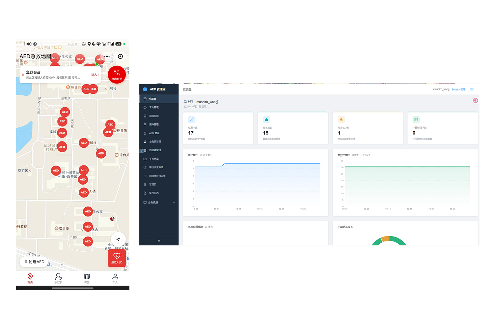

<div align="center">


# AED 急救协作系统

面向校园与园区的 AED 设备检索、紧急求助调度与实时急救协作平台。

`uni-app` · `Vue 3` · `TypeScript` · `Element Plus` · `ASP.NET Core (.NET 10)` · `SQLite`

</div>

---

## 项目简介

**AED 急救协作系统**是一套完整的园区应急响应与急救科普解决方案，包含微信小程序端、Web 管理后台与 .NET 后端服务。
系统围绕“快速找设备、一键发求助、多方实时协同、日常学急救”四个核心环节设计，支持通过单一站点配置文件快速适配不同学校、园区或社区机构。

系统内置完整的本地演示数据集与多角色切换机制（求助人、认证急救员、普通用户），开箱即可在本地体验从发起紧急求助、急救员接单响应、位置共享与图文协同，到后台监控与结案归档的全流程闭环。

可根据园区状况，自由修改使用。

<div align="center">
    
</div>

## 核心特性

### 小程序端
- **AED 设备地图与检索**：按校区与状态筛选周边 AED 设备，查看安装位置、开放时间、实景说明与距离排序。
- **紧急求助发布**：一键发起求助并自动关联就近校区与坐标，支持现场情况描述与多图上传。
- **实时急救会话**：认证急救员接单加入会话，支持实时位置上报、现场消息互动、状态通报（如已出发、已取到 AED、已到达现场）以及 HTTP 快照 + WebSocket 实时推送。
- **急救知识课堂**：提供结构化急救课程，支持日常急救技能科普。后台也可根据园区情况定制专属急救课程。
- **急救员资质认证**：支持用户在线提交急救培训证书，经后台审核通过后获得接单响应权限。

### 管理后台
- **数据概览与监控看板**：直观展示设备分布、求助趋势、响应数据与当前活跃的急救会话详情。
- **AED 设备台账管理**：维护设备坐标、所在楼宇、负责校区、巡检状态与现场图片。
- **用户与急救员审核**：管理注册用户档案，在线审批急救员资质申请并记录审核意见。
- **求助记录与课程管理**：查询历史求助全链路时间线，发布与维护急救课程。
- **系统审计日志**：完整记录后台关键管理操作，保障运维可追溯。

### 服务端与工程化
- **多校区集中配置**：通过根目录 `config/site.json` 统一定义机构名称、地图中心、下属校区与服务半径，三端自动同步。
- **三档运行模式**：内置纯前端预览（`mock`）、本地全栈联调（`local-demo`）与微信正式环境（`wechat`）三种运行档位。
- **清晰的分层架构**：后端采用 ASP.NET Core Minimal API，按 `Api`、`Core`、`Infrastructure` 分层，配套完整的单元与集成测试。

## 目录结构

```text
AED-Emergency-System/
├── config/site.json                 # 机构信息、地图中心、校区列表与服务半径配置
├── demo/                            # 本地演示数据集、预设角色与数据校验工具
├── miniprogram/                     # 微信小程序端（uni-app + Vue 3 + Pinia + TypeScript）
├── admin/                           # Web 管理端（Vue 3 + Vite + Element Plus + ECharts）
├── backend/                         # 后端服务（.NET 10 Minimal API + SQLite + 测试套件）
├── scripts/setup-project.ps1        # 站点与本地环境配置生成脚本
└── scripts/start-local-demo.ps1     # 本地全栈演示环境一键启动脚本
```

## 快速开始

### 环境要求

- **.NET SDK**：`10.0` 及以上
- **Node.js**：`22.13+` 或 `24+`
- **pnpm**：`10+`
- **PowerShell**：`7+`（用于执行自动化启动脚本）

### 一键启动本地演示

在仓库根目录执行以下命令，即可自动完成数据校验、前端构建、SQLite 演示库初始化、后端服务启动及管理员账号引导：

```powershell
pwsh -File scripts/start-local-demo.ps1
```

常用启动参数：

```powershell
# 仅构建前端并初始化 SQLite 演示库
pwsh -File scripts/start-local-demo.ps1 -PrepareOnly

# 复用已初始化的演示数据库直接启动
pwsh -File scripts/start-local-demo.ps1 -SkipInit

# 修改代码或站点配置后强制重新构建前端产物
pwsh -File scripts/start-local-demo.ps1 -SkipInit -RebuildFrontends
```

服务启动后即可访问：

- **Web 管理后台**：`http://127.0.0.1:5150/admin/`
- **Swagger API 文档**：`http://127.0.0.1:5150/swagger`
- **健康检查端点**：`http://127.0.0.1:5150/health`
- **小程序端预览**：使用微信开发者工具导入 `miniprogram/dist/build/mp-weixin`

### 运行模式

小程序与后端支持三种运行档位，适应不同开发与部署阶段：

| 模式 | 适用场景 | 说明 |
| --- | --- | --- |
| `mock` | 纯前端交互预览 | 使用前端内置演示数据运行，适合快速浏览页面与交互流程 |
| `local-demo` | 本地全栈联调 | 连接本地 SQLite 与后端 API，支持多角色切换与实时会话联调 |
| `wechat` | 微信正式环境 | 接入真实微信登录、地图服务、消息订阅与线上存储 |

### 手动构建与启动

如需分步运行各端服务，可按以下流程操作：

**1. 安装依赖与初始化演示数据**

```powershell
pnpm --dir miniprogram install --frozen-lockfile
pnpm --dir admin install --frozen-lockfile

$dataRoot = "$env:TEMP\aed-local-demo"
dotnet run --project backend/src/AedBackend.Api -- init-demo-data --data-root $dataRoot
```

**2. 构建管理端与启动后端**

```powershell
pnpm --dir admin build

$env:ASPNETCORE_ENVIRONMENT = 'Development'
$env:AED_DATA_PROVIDER = 'Sqlite'
$env:AED_SQLITE_PATH = "$dataRoot\aed.db"
$env:WeChat__UploadsDirectory = "$dataRoot\uploads"
$env:AED_API_PUBLIC_BASE_URL = 'http://127.0.0.1:5150'
$env:AED_PUSH_ADMIN_KEY = '<自定义引导密钥>'
$env:AED_ADMIN_SESSION_HASH_SECRET = '<自定义会话密钥>'
$env:Demo__Enabled = 'true'
dotnet run --project backend/src/AedBackend.Api --launch-profile http
```

服务启动后，可通过引导接口创建初始管理员账号：

```powershell
curl.exe -X POST http://127.0.0.1:5150/api/admin/auth/bootstrap `
  -H "Content-Type: application/json" `
  -H "X-Aed-Admin-Key: <自定义引导密钥>" `
  -d '{"username":"admin","password":"<管理员密码>"}'
```

**3. 构建微信小程序**

```powershell
$env:VITE_APP_MODE = 'local-demo'
$env:VITE_API_BASE_URL = 'http://127.0.0.1:5150'
pnpm --dir miniprogram build:mp-weixin
```

## 站点定制与配置

机构名称、应用标题、地图中心坐标、下属校区与服务半径均集中在 [`config/site.json`](config/site.json) 中管理：

```json
{
  "schemaVersion": 1,
  "site": {
    "organizationName": "示范园区",
    "appTitle": "AED 急救协作",
    "adminTitle": "AED 管理端",
    "coordinateSystem": "gcj02",
    "map": {
      "center": { "latitude": 31.2315, "longitude": 121.4785 },
      "searchCity": "上海"
    },
    "campuses": [
      { "code": "east", "name": "东区", "center": { "latitude": 31.245, "longitude": 121.505 } },
      { "code": "west", "name": "西区", "center": { "latitude": 31.218, "longitude": 121.452 } }
    ],
    "serviceRadiusKm": 30,
    "rescuePhone": ""
  }
}
```

各端环境变量配置：

- **小程序端**（`miniprogram/.env.*`）：配置 `VITE_APP_MODE`、`VITE_API_BASE_URL` 与腾讯位置服务密钥 `VITE_TENCENT_MAP_KEY`。
- **管理后台**（`admin/.env.local`）：配置高德地图 JS API 密钥 `VITE_AMAP_KEY` 与 `VITE_AMAP_SECURITY_CODE`。
- **后端服务**：通过环境变量或 `appsettings.Development.local.json` 配置数据库连接、上传目录与微信接口凭证。

## 开发与测试

```powershell
# 后端编译、测试与代码格式检查
dotnet build backend/AedBackend.sln
dotnet test backend/AedBackend.sln
dotnet format backend/AedBackend.sln --verify-no-changes

# 小程序端类型检查、代码规范、单元测试与契约校验
pnpm --dir miniprogram typecheck
pnpm --dir miniprogram lint
pnpm --dir miniprogram test
pnpm --dir miniprogram contract:validate

# 管理后台代码规范、单元测试与生产构建
pnpm --dir admin lint
pnpm --dir admin test
pnpm --dir admin build
```

## 许可证

本项目基于 [GNU General Public License v3.0](LICENSE) 开源。
