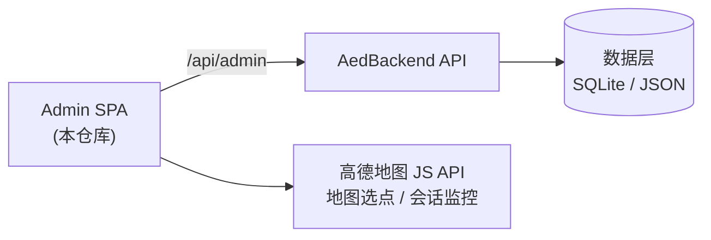

# AED Admin Portal

> REDACTED校园 AED 急救小程序管理端 — Vue 3 + Vite + TypeScript Web SPA

面向运营与管理人员的中后台系统：监控求助与急救会话、审核救助报告、管理 AED 设备、急救课堂、用户与急救员、志愿者/学校身份审核，并保留完整的操作审计。

---

## 目录

- [项目简介](#项目简介)
- [功能特性](#功能特性)
- [技术栈](#技术栈)
- [架构设计](#架构设计)
- [快速开始](#快速开始)
- [环境配置](#环境配置)
- [页面与路由](#页面与路由)
- [测试与质量](#测试与质量)
- [部署](#部署)
- [目录结构](#目录结构)
- [文档与维护](#文档与维护)

---

## 项目简介

本仓库是 AED 急救体系的管理端，与以下仓库相邻协作：

| 仓库 | 定位 | 远程 |
|------|------|------|
| **Admin**（本仓库） | 管理端 Web SPA | `fukaross/AED-Admin`（private） |
| **Design** | 小程序前端 + 接口规格 | `fukaross/REDACTED` |
| **AedBackend** | 后端 API | `fukaross/REDACTED`（private） |

管理端通过 `GET/PUT /api/admin/*` 与后端交互，构建产物由后端 `/admin/` 静态托管，生产访问 `REDACTED/admin/`。

## 功能特性

- **认证与权限**：管理员登录（账号密码 + session key）、超级管理员初始化（bootstrap）、会话管理（限 3 设备）、密码重置、登录失败锁定
- **仪表盘**：KPI 概览、图表（ECharts）、最近操作日志，5 秒刷新
- **求助管理**：求助列表 / 详情、审核关闭、误报标记（10 秒轮询）
- **急救会话监控**（只读）：进行中 / 历史列表与详情，SOS、参与者实时位置（高德多 marker）、信号、拿取 AED / 到达状态、消息与状态时间线；页面隐藏暂停轮询，关闭后停止
- **AED 设备管理**：列表 / 详情 / 新增 / 编辑 / 删除、图片上传、离线必填备注
- **急救员管理**：列表 / 详情编辑（头像上传、技能与考核结果）；资格从急救员档案只读同步
- **急救课堂**：统计横幅、关键步骤、课程管理（富文本编辑、图片/视频上传）
- **用户管理**：列表 / 详情 / 局部更新；只维护身份、账号状态与备注，急救资格只读同步
- **身份审核**：志愿者申请、学校档案维护、学校绑定、急救员认领审核
- **管理员管理**：超管创建 / 查看 / 删除普通管理员、重置密码
- **审计日志**：操作日志查询（`eventType / eventName / targetId` 模型）

## 技术栈

| 类别 | 选型 |
|------|------|
| 框架 | Vue 3 + Vite + TypeScript |
| UI | Element Plus |
| 状态管理 | Pinia |
| 路由 | Vue Router |
| 网络 | Axios（统一拦截 401 登出） |
| 图表 | ECharts + vue-echarts |
| 地图 | 高德地图 JS API 2.0（`@amap/amap-jsapi-loader`） |
| 富文本 | Tiptap |
| 测试 | Vitest |
| 包管理 | pnpm ≥ 10 |

## 架构设计



- 前端只消费 `/api/admin/*` 正式契约；`/api/ops/*`、`/api/dev/*` 仅作兼容，不作为业务契约
- 急救会话监控一期为**严格只读**（HTTP 查询，不支持发言 / 代改状态 / 位置写入）
- 列表 / 详情页采用轮询 + abort / request sequence / generation 栅栏，防止迟到响应与轮询复活

## 快速开始

### 环境要求

| 工具 | 版本 |
|------|------|
| Node.js | ≥ 18 |
| pnpm | ≥ 10 |

### 安装与运行

```powershell
# 安装依赖（仓库已提交 pnpm-lock.yaml）
pnpm install

# 开发模式（默认代理 /api 到 http://localhost:5000，需本地启动后端）
pnpm dev

# 生产构建（产物输出到 ../AedBackend/src/AedBackend.Api/wwwroot/admin/）
pnpm build

# 本地预览构建产物
pnpm preview
```

> 开发模式下需先本地运行 AedBackend（`dotnet run --project src/AedBackend.Api`），Vite 会将 `/api` 代理到 `http://localhost:5000`。

## 环境配置

环境变量通过 `.env` 文件注入，模板见 `.env.example`：

| 变量 | 说明 |
|------|------|
| `VITE_AMAP_KEY` | 高德地图 Web 端 JS API Key（**不提交仓库，需向维护者获取**） |
| `VITE_AMAP_SECURITY_CODE` | 高德地图安全密钥 |

> 未配置高德 Key 时，地图相关功能（AED 设备地图选点、急救会话多 marker 监控）会显式报错，其余功能不受影响。

## 页面与路由

| 路由 | 说明 |
|------|------|
| `/login` | 登录 |
| `/dashboard` | 仪表盘 |
| `/help-requests`、`/help-requests/:id` | 求助列表 / 详情（审核关闭、误报标记） |
| `/rescue-sessions`、`/rescue-sessions/:helpId` | 急救会话只读监控列表 / 详情 |
| `/users`、`/users/:openId` | 用户列表 / 详情 |
| `/devices`、`/devices/:id` | AED 设备列表 / 详情 |
| `/rescuers`、`/rescuers/:id` | 急救员列表 / 详情 |
| `/volunteer-applications`、`/:id` | 志愿者申请审核 |
| `/school-profiles`、`/:id` | 学校档案维护 |
| `/school-bindings`、`/:id` | 学校绑定审核 |
| `/responder-claims` | 急救员认领审核 |
| `/admins`、`/admins/:id` | 管理员管理 |
| `/audit-logs` | 审计日志 |
| `/classroom/*` | 急救课堂（统计横幅 / 关键步骤 / 课程） |
| `/sessions` | 旧版会话入口（保留兼容） |

## 测试与质量

```powershell
pnpm test        # 单元测试：当前 81/81 通过
pnpm typecheck   # Vue + Node 双 TypeScript 检查
pnpm lint        # ESLint
pnpm build       # 类型检查 + Vite 构建
```

质量门禁：`test` / `typecheck` / `lint` / `build` 全绿为合入前提。

## 部署

1. 配置 `.env`（高德 Key / 安全码）
2. `pnpm build` — 产物输出到 `../AedBackend/src/AedBackend.Api/wwwroot/admin/`
3. 部署 AedBackend（含 `wwwroot/admin/`），由后端 `/admin/` 静态托管
4. 生产访问 `REDACTED/admin/`

边界约定：

- Vite `base` 为 `/admin/`，API base 为 `/api/admin`
- `node_modules/`、`dist/`、`.env*`（除 `.env.example`）、运行时数据均不入库
- 不提交构建产物；每次构建后随后端一起发布

## 目录结构

```text
Admin/
├── src/
│   ├── api/              # 领域 API（auth/users/help/devices/rescuers/classroom/...）
│   ├── components/       # 布局 / 地图 / 富文本 / 状态标签等通用组件
│   ├── composables/      # 会话监控、地图选点等业务逻辑
│   ├── pages/            # 页面（dashboard/help-requests/rescue-sessions/users/devices/rescuers/classroom/admins/audit-logs/...）
│   ├── router/           # 路由
│   ├── stores/           # Pinia 状态
│   ├── utils/            # 高德加载器等工具
│   ├── App.vue / main.ts
│   └── *.test.ts         # 单元测试
├── .env.example          # 环境变量模板
├── vite.config.ts        # 构建 / 代理配置
└── package.json
```

## 文档与维护

### 文档导航

| 文档 | 用途 |
|------|------|
| `README.md`（本文件） | 工程概览与交接说明（随仓库分发） |
| `AGENTS.md`、`CONTEXT.md`、`UPDATE.md`、`DESIGN.md` | 本地协作 / 设计文档（**不随仓库分发**，需向维护者索取） |
| `AedBackend/Design/BackEnd.md` | 后端接口权威规格（本地文档） |

### 交接信息

| 项 | 说明 |
|----|------|
| 当前版本 | 0.1.0 |
| 生产访问 | `REDACTED/admin/` |
| 主要负责人 | 项目维护者（fukaross） |
| 问题跟踪 | GitHub Issues（`fukaross/REDACTED`） |

### 已知边界

- 急救会话监控一期为只读；发言 / 代改状态 / 位置写入属后续迭代
- 登录需后端已初始化超级管理员（bootstrap），且配置 `AED_PUSH_ADMIN_KEY` 与 `AED_ADMIN_SESSION_HASH_SECRET`
- 地图功能依赖高德 Key；未配置时仅地图模块不可用
