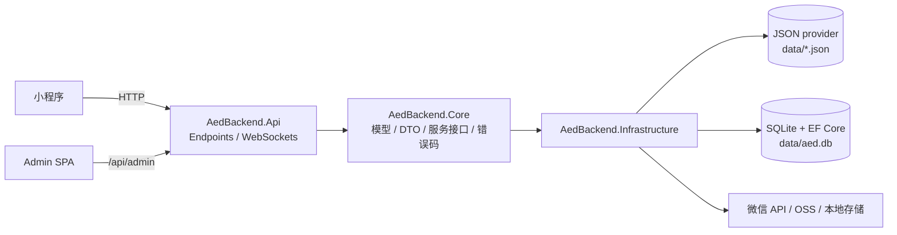

# AED Backend

> REDACTED校园 AED 急救微信小程序后端服务 — ASP.NET Core Minimal API

为小程序端与管理端提供统一后端能力：用户认证、AED 设备、求助与急救会话、急救课堂、急救员与志愿者运营，以及管理端后台 API。

---

## 目录

- [项目简介](#项目简介)
- [功能特性](#功能特性)
- [技术栈](#技术栈)
- [架构设计](#架构设计)
- [快速开始](#快速开始)
- [环境配置](#环境配置)
- [数据存储](#数据存储)
- [API 概览](#api-概览)
- [测试与质量](#测试与质量)
- [部署](#部署)
- [目录结构](#目录结构)
- [文档与维护](#文档与维护)

---

## 项目简介

本仓库是 AED 急救体系的后端服务，与以下仓库相邻协作：

| 仓库 | 定位 | 远程 |
|------|------|------|
| **AedBackend**（本仓库） | 后端 API + WebSocket | `fukaross/REDACTED`（private） |
| **Design** | 小程序前端 + 接口规格 | `fukaross/REDACTED` |
| **Admin** | 管理端 Web SPA | `fukaross/AED-Admin`（private） |

核心职责：

- 小程序端全部业务 API（认证 / AED / 求助 / 急救会话 / 课堂 / 用户 / 急救员）
- 急救会话 WebSocket 推送扇出（HTTP 为读写真源）
- 管理端 `/api/admin/*` 后台 API（登录 / 仪表盘 / 求助审核 / 设备 / 课堂 / 用户 / 审计）
- 微信订阅消息推送、图片/视频上传、静态托管 Admin 构建产物

## 功能特性

- **认证**：微信登录（自定义 opaque token，30 天有效期 + 自动刷新）、游客匿名求助凭据、Admin 账号密码 + session key
- **AED 设备**：附近设备查询（距离排序、在线优先）、设备 CRUD 与状态管理
- **求助闭环**：发布 / 详情 / 报告 / 审核关闭 / 误报标记，`published → responding → pending_review → closed` 状态模型
- **急救会话**（2026-07 上线）：求助人 + 认证急救员 1:1 会话聚合，参与者 / 消息 / 状态事件 / 实时位置，WebSocket 推送 + 断线轮询降级，仅认证急救员准入并收窄推送
- **急救课堂**：统计横幅、课程、关键步骤；课程阅读量计数（`POST /api/courses/{id}/views`）
- **急救员与志愿者**：急救员档案（资格只读同步）、志愿者申请、学校档案 / 绑定、急救员认领
- **管理端 API**：仪表盘、求助/会话只读监控、用户/管理员/审计日志、AED/课堂/急救员管理
- **上传**：图片/视频，Local 与阿里云 OSS 双实现
- **兼容层**：`/api/ops/*`、`/api/dev/*` 兼容入口（非业务契约）

## 技术栈

| 类别 | 选型 |
|------|------|
| 框架 | ASP.NET Core Minimal API |
| 目标框架 | .NET 10 |
| 分层 | `Api`（端点）→ `Core`（DTO/模型/接口/错误码）→ `Infrastructure`（持久化/微信/上传） |
| 数据访问 | EF Core + SQLite（生产）；JSON provider（默认，回滚源与历史兼容） |
| 认证 | 小程序自定义 token；Admin 账号密码 + session key（均非 JWT） |
| 实时 | WebSocket（急救会话推送扇出，RFC 6455，非 SignalR） |
| 上传 | Local（默认）/ 阿里云 OSS |
| 测试 | xUnit（`tests/AedBackend.Tests`） |

## 架构设计



关键决策：

- **双数据 Provider**：默认 JSON（文件不存在自动写种子，便于本地起步与回滚）；生产 SQLite。API 契约不随 Provider 改变
- **WebSocket 仅扇出**：HTTP 为读写真源，WS 只推送；断线自动降级轮询（ADR: `docs/adr/0001-websocket-fanout-for-rescue-sessions.md`）
- **错误码体系**：统一 `{ code, message, data }` 响应壳 + 业务错误码（如 1016/1017 会话错误、1018 账号禁用、2004/2005 AED 错误）

## 快速开始

### 环境要求

- [.NET 10 SDK](https://dotnet.microsoft.com/download/dotnet/10.0)

### 构建与运行

```powershell
# 构建（4 个项目）
dotnet build

# 本地启动（默认 JSON provider，首次运行自动生成 data/ 种子文件）
dotnet run --project src/AedBackend.Api
```

启动后可访问：

| 端点 | 说明 |
|------|------|
| `GET /` | 服务信息 |
| `GET /health` | 健康检查 |
| `GET /swagger` | Swagger UI（仅 Development） |
| `GET /api/aed/nearby?lat=..&lng=..` | 附近 AED（种子 24 台） |
| `GET /admin/` | 管理端静态页面（需先构建 Admin） |

## 环境配置

密钥与凭据**均不提交仓库**，通过环境变量或 `appsettings.json` 注入（模板见 `appsettings.json` / `deploy/systemd/REDACTED-paths.env.example`）：

| 变量 | 说明 |
|------|------|
| `WECHAT_APP_ID` / `WECHAT_APP_SECRET` | 微信小程序凭据；为空时微信登录 / 订阅链路不可用 |
| `WECHAT_SUBSCRIBE_TEMPLATE_ID` | 订阅消息模板 ID |
| `AED_PUSH_ADMIN_KEY` | Admin bootstrap / reset-super-admin 初始化密钥 |
| `AED_ADMIN_SESSION_HASH_SECRET` | Admin session HMAC-SHA256 密钥；缺失时 Admin 登录返回 500 |
| `AED_API_PUBLIC_BASE_URL` | 对外基础地址（推送跳转、静态资源等） |
| `AED_DATA_PROVIDER` | `Json`（默认）或 `Sqlite` |
| `AED_SQLITE_PATH` | SQLite 数据库路径 |
| `Upload__Provider` | `Local`（默认）或 `Oss` |
| `Upload__Oss__*` | OSS Endpoint / BucketName / AccessKeyId / AccessKeySecret |

> 生产部署时必须配置 `WECHAT_*`、`AED_PUSH_ADMIN_KEY`、`AED_ADMIN_SESSION_HASH_SECRET` 后方可跑通完整业务链路。

## 数据存储

### JSON Provider（默认）

- 数据文件位于 `data/*.json`（运行时数据，不入库）
- 文件不存在时自动写种子：AED 设备 24 台、课程 4 门、急救员、统计横幅、管理员等
- 适合本地开发、演示与回滚

### SQLite Provider（生产）

```powershell
# 1. 先显式迁移（不要手工建库）
dotnet run --project src/AedBackend.Api -- migrate-json-to-sqlite --data-root <JSON目录> --db <SQLite路径>

# 2. 设置环境变量后启动
$env:AED_DATA_PROVIDER = "Sqlite"
$env:AED_SQLITE_PATH = "data/aed.db"
dotnet run --project src/AedBackend.Api
```

> 使用 SQLite 时若数据库不存在，启动会显式报错并要求先执行迁移，不会自动建库；迁移前会做冲突校验与只读诊断，不自动删改数据。

## API 概览

| 分组 | 前缀 | 说明 |
|------|------|------|
| 微信认证 | `/api/auth/*`、`/api/wechat/*` | 登录、手机号、订阅授权、refresh |
| AED | `/api/aed/*` | 附近设备、设备列表 |
| 求助 | `/api/help/*` | 发布、详情、报告、状态、会话入口 |
| 急救会话 | `/api/rescue-sessions/*`、`/ws/help/{id}/session` | 会话读写 + WebSocket |
| 课堂 | `/api/knowledge/*`、`/api/courses/*`、`/api/quick-actions/*` | 统计、课程、关键步骤 |
| 急救员 / 用户 | `/api/rescuers/*`、`/api/user/*` | 档案、用户资料、志愿者、学校、认领 |
| 上传 | `/api/uploads/*` | 图片 / 视频 |
| 管理端 | `/api/admin/*` | bootstrap / 登录 / 仪表盘 / 求助 / 会话 / 用户 / 管理员 / 设备 / 课堂 / 审计 |
| 兼容 | `/api/ops/*`、`/api/dev/*` | 历史兼容（非业务契约） |

完整契约见 `Design/BackEnd.md`（本地文档，需向维护者索取）与 `Design/app/contracts/openapi.yaml`。

## 测试与质量

```powershell
dotnet build                        # 构建：4 projects / 0 errors / 0 warnings
dotnet test                         # 单元测试：当前 338/338 通过
dotnet format --verify-no-changes   # 格式校验
```

测试覆盖：认证、AED、求助、急救会话（JSON/SQLite 双 provider、WebSocket smoke）、课堂、急救员、用户、Admin API、审计、迁移等。

## 部署

- **生产环境**：Linux + systemd，监听 `127.0.0.1:5150`，由 Nginx 反代 HTTPS
- **数据目录**：运行数据必须在 `/opt/REDACTED/data`，不得回落到 `app/data`；任何部署不得覆盖线上运行时数据
- **配置示例**：`deploy/systemd/REDACTED-paths.env.example`、`deploy/nginx/aed-api-websocket.conf.example`
- **管理端静态托管**：先执行 Admin 仓库 `pnpm build`，产物输出到 `src/AedBackend.Api/wwwroot/admin/`，由本服务 `/admin/` 托管
- **发布**：`dotnet publish` 后打包部署；Windows 打出的包不保留可执行位，需 `chmod 755` 后启动

## 目录结构

```text
AedBackend/
├── src/
│   ├── AedBackend.Api/            # 启动项 + Endpoints + WebSockets
│   ├── AedBackend.Core/           # 模型 / DTO / 服务接口 / 错误码 / 常量
│   └── AedBackend.Infrastructure/ # SQLite/JSON provider、微信、上传、种子数据
├── tests/AedBackend.Tests/        # xUnit 单元测试
├── deploy/                        # systemd / Nginx 配置示例
├── docs/adr/                      # 架构决策记录
├── docs/agents/                   # Agent 协作说明
└── AedBackend.sln
```

## 文档与维护

### 文档导航

| 文档 | 用途 |
|------|------|
| `README.md`（本文件） | 工程概览与交接说明（随仓库分发） |
| `AGENTS.md`、`CONTEXT.md` | 后端真实进展与协作约定（**本地文档，不随仓库分发**） |
| `Design/BackEnd.md` | 后端接口权威规格（本地文档，需向维护者索取） |
| `docs/adr/` | 架构决策记录 |
| `deploy/` | 部署配置示例 |

### 交接信息

| 项 | 说明 |
|----|------|
| 当前版本 | 0.1.0 |
| 生产环境 | `api.example.invalid`（HTTPS，Nginx 反代） |
| 主要负责人 | 项目维护者（fukaross） |
| 问题跟踪 | GitHub Issues（`fukaross/REDACTED`） |

### 已知边界

- 游客匿名发布求助待产品最终确认（当前保留匿名凭据实现）
- Nginx `/ws/` Upgrade 与 HTTPS/WS 线上核验、双人真机 smoke 仍待执行
- `/api/help/{id}/respond` 与急救员可用性接口为前端未使用的历史封装，未改产品语义
